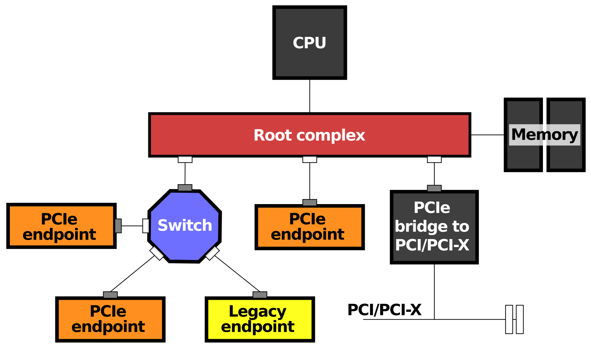
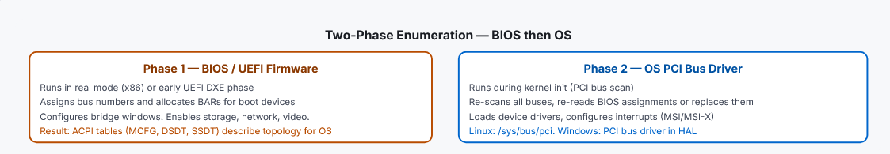

# PCIe FPGA Driver

В данном репозитории представлен драйвер для FPGA платы,
а также userspace-приложение, отвечающее за генерацию трафика.

---
## Файловая структура проекта
```
.
├── driver
│   ├── include
│   │   ├── cdev.h
│   │   ├── irq.h
│   │   ├── pci.h
│   │   └── registers.h
│   └── src
│       ├── pci.c
│       ├── irq.c
│       ├── cdev.c
│       └── sysfs.c
└── userspace_app
    ├── src
    └── data
```

---
## Драйвер
Драйвер состоит из нескольких .c файлов:

- pci.c - главный файл драйвера. Именно здесь находятся функции probe и remove.
- irq.c - файл, отвечающий за инициализацию аппаратных прерываний.
- cdev.c - файл, отвечающий за инициализацию character device для доступа к системным вызовам.
- sysfs.c - файл, от вечающий за инициализацию интерфейса настроек sysfs

---
## Userspace-приложение
- src/main.c - главный файл пользовательского приложения.
- data/traffic.pcap - файл с траффиком для проигрывания

Приложение использует libtcpreplay для генерации трафика. Это тот же движок tcpreplay, только обернутый в библиотеку, от тех же разработчиков.
Перед первым запуском необходимо выполнить ```sudo make install-dep```

# Процесс инициализации PCI-устройства


Далее описан процесс обнаружения и инициализации PCIe-устройства на конкретной платформе, а также архитектура PCI-шины. Приведён он для понимания того, в каком состоянии драйвер получает устройство
и какую роль выполняют его функции

## Архитектура PCI-шины
[Источник](https://en.wikipedia.org/wiki/Root_complex)


В системе PCI Express сущность корневой комплекс соедняет центральный процессор и подсистему памяти с внутренней структурой
PCIe или PCI. Корневой комплекс может иметь несколько портов PCI Express. К этим портам также можно подключить коммутаторы (см. рисунок)



Корневой комплекс создаёт запросы транзакций от имени центрального процессора, **соединенного с ним через локальную шину**.
Под запросами транзакций здесь имеются ввиду PCIe-запросы на чтение и запись. Например, процессор выполняет инструкцию, обращающуюся к регистрам
устройства - в его BAR. Корневой комплекс передает это обращение, превращая его в PCI-транзакцию по PCI до нужного устройства и обновляет соответсвующий регистр (если это был, например, write)


## Подаётся питание и снимается reset
_Источник - нейросеть_
 1. Блок питания подаёт напряжение на материнку и на пеферийные устройства
   2. Процессор и часть переферии удерживается при низком reset_n, пока питание и тактирование не станут стабильными
   3. Сигнал reset_n поднимается в предусмотренной последовательности 
   4. Процессор исполняет код начальной загрузки из прошивки (BIOS/UEFI)
## Физический уровень пытается установить канал связи 
[Источник](https://dev.to/ripan030/understanding-pcie-link-training-165i)

Физический уровень пытается установить канал связи между Root Port (порт Root Complex'а) и подключенным устройством - Endpoint 
   1. Detect: передатчик проверяет, есть ли на линии приёмник
   2. Polling: устройства отправляют друг другу специальные данные. По ним приёмники настраивают синхронизацию и подтверждают обмен
   3. Configuration: устройства назначают линиям онмера и согласуют ширину соединения
   4. Соединение начинает передавать данные, соединение в статусе L0

## Enumeration - перечисление PCI устройств 
[Источник](https://vlsitrainers.com/pcie-enumeration/)

Когда компьютер включается, процессор еще ничего не знает о устройствах на PCI шине. Он даже не знает сколько существует шин. Перечисление - 
это процесс, который выясняет всё это: система последовательно обходит структуру PCIe, обнаружвает устройства и настраивает их для работы. Если конкретнее, то на этом
этапе назначаются номера шин (от 0 до 255), **выделяются адреса BAR** и выполняются прочие задачи.

Обычно енумерация проходит в несколько этапов:
1. Сначала BIOS выполняет первоначальную настройку, чтобы компьютер мог загрузиться
2. Затем ОС выполняет перечисление заново, строит собственное дерево устройств и назначает векторы MSI/MSI-X (по запросу драйвера) через свою систему управления прерываниями


### Адресация BDF
Каждая функция PCIe однозначно определяется адресом BDF - Bus, Device, Function (например, 00:1f.3). 
Устройство обнаруживается следующим образом: 32 битное чтение конфигурационного пространства по смещению 00h для заданного BDF. Там находятся Vendor ID и Device ID. Одно чтение 
возвращает сразу оба значения. Программа проверяет поле Vendor ID - биты [15:0]. Допустимый ID 0001h-FFFEh. Если устройство вернуло FFFFh, то либо его нет, либо оно вернуло Unsupported Request.
Таким образом проверяются все сочетания Bus, Device, Function. Далее читается регистр Header Type по смещению 0Ch, который определяет, каким образом дальше читать конфигурационное пространство, сколкьо функций реализует устройство.

После обнаружения конечного устройс тва и подтверждения его типа (Header Type), программа выделяет адресное пространство для каждого BAR. Процедура определения размера выглядит так:
- Записать 0xFFFFFFFF в BAR
- Считать значение обратно. Позиция младшего установленного бита в поле адреса показывает требуемый размер.
- Выделить диапазон нужного размера
- Повторить для всех шести BAR

## Запуск и работа ОС
_Источник - нейросеть_

UEFI находит загруочное устройство и запускает загрузчик. Загружается ядро Linux, прошивка передает управление ему. С этого момента Linux начинет собственную инициализацию.
Настройки, которые выставил BIOS - это исходное состояние платформы,** но Linux не обязан просто принять его без проверки. **

Linux сканирует PCI-шины и читает configuration space обнаруженных функций (вспоминаем BDF). Ядро создает для каждого найденного устройства внутренний объект ``struct pci_dev`` 

Затем Linux анализирует и распределяет ресурсы устройств. В зависимости от архитектуры, прошивки, параметров ядра и доступности ресурсов Linux может сохранить выданные прошивкой адреса или переназначить часть ресурсов. **Поэтому адрес BAR и BDF не следует считать константами**
Драйвер pci регистрируется в ядре обычно через ``pci_register_driver()``. Он передает таблицу ``struct pci_device_id`` с необходимыми Vendor ID и Device ID.
При регистрации драйвера ядро проверяет уже обнаруженные устройства. Когда такое находится, вызывается функция драйвера ``probe()``
